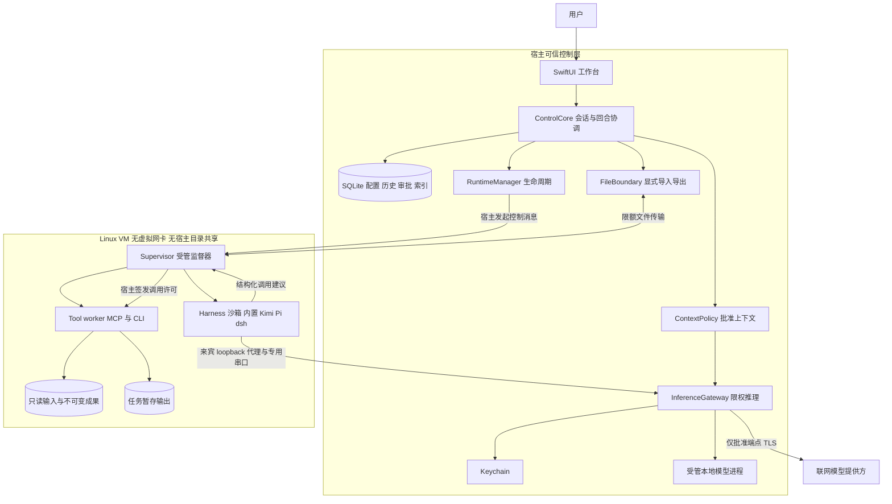
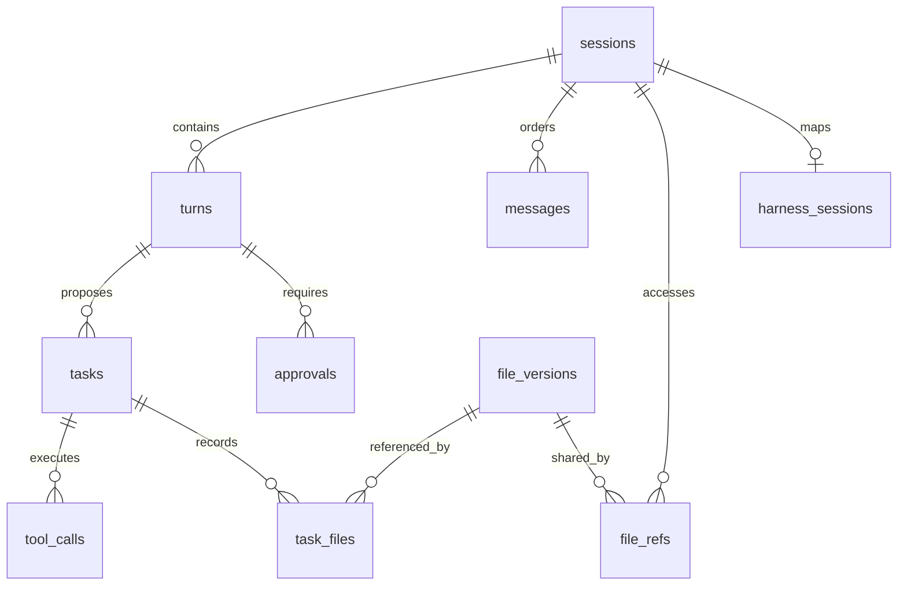
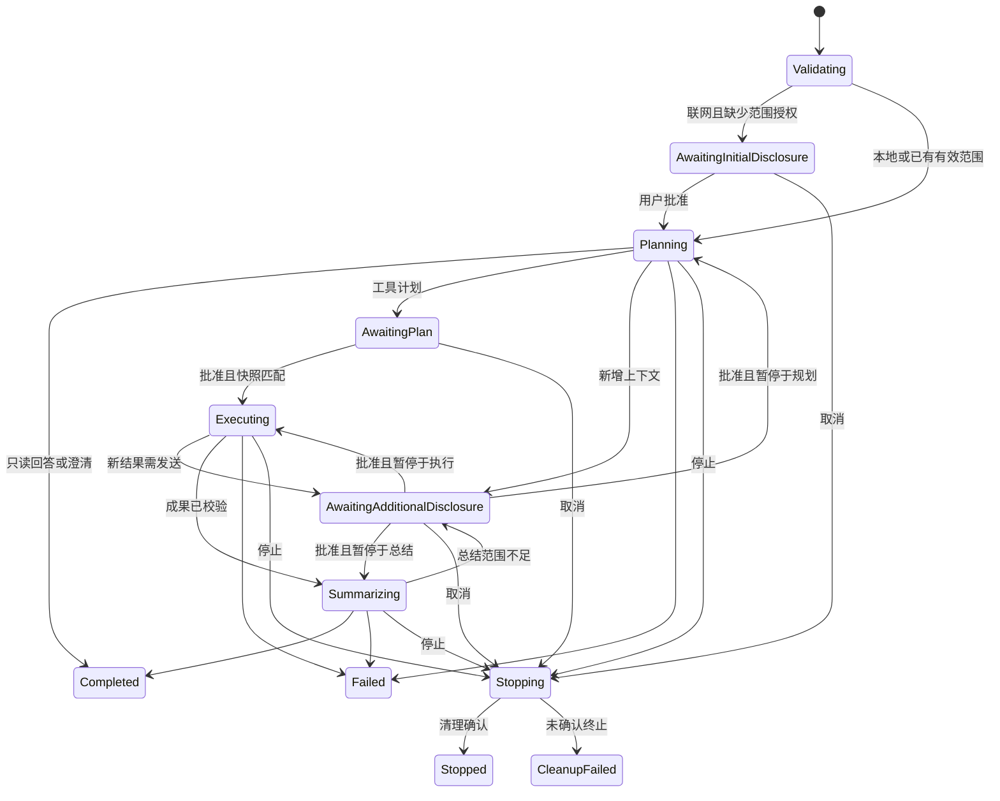

# Havenbox 技术方案

版本：V0.2

日期：2026-10-23

依据：[PRD V0.5](./product-requirements.md)、[UI 与用户动线](./ui-ux-design.md)、[产品调研](./research-report.md)

关联：[PRD 对照评审](./technical-review.md)、[开发任务](./development-tasks.md)

状态：经 PRD 对照修订的架构设计稿，供实现与评审使用。仓库已有产品文档及可点击模拟原型，无产品实现、产品构建配置或真实集成测试；本文的组件、目录、接口与限制均为拟实现设计。

## 1. 目标与设计约束

本期交付 Apple Silicon macOS 内部版，在一个持久工作空间内支持多会话、单活动回合。内置 Agent、Kimi CLI、Pi、dsh 分别通过适配器使用独立配置的模型与工具。三种外部 harness 各完成一条联网组合，至少一条 harness 组合完成物理断网验收，同一联网模型配置至少被两种 harness 复用。MCP 与 CLI 均需真实执行，不能用内置路径替代外部接入验收。

本地推理使用宿主 GPU，文件计算留在 Linux 虚拟机。联网无需安装本地模型，所有业务发送先授权，API Key 留在宿主。模型与文件内容都不能扩大权限；原件不改写，成果由用户预览并显式导出。原生会话恢复和历史摘要重建分别展示，恢复不自动重放请求或工具。

非目标沿用 PRD：远程 MCP、OAuth、任意 shell、浏览器自动化、开放式编程、后台任务队列、多工作空间和公开分发。本文不改变产品范围。

## 2. 技术决策与候选方案

### 2.1 推荐基线

| 层次 | 推荐方案 | 理由与实施条件 |
| --- | --- | --- |
| 桌面 UI | SwiftUI，必要时使用 AppKit 文件面板与表格 | 本期仅 macOS，直接集成文件授权、凭据与应用生命周期 |
| 宿主控制核心 | Swift 模块，actor 串行协调状态；SQLite 持久化 | 避免首版额外引入 UI 到核心的跨语言接口，数据库由单一进程写入 |
| Linux 运行时 | 受管 QEMU ARM 虚拟机，HVF 加速 | 复用成熟虚拟机运行时，显式控制设备、磁盘与通信通道 |
| 来宾监督器与工具 | Rust supervisor、CSV 引擎及 MCP/CLI 入口 | 路径与资源约束集中实现，CSV 算法由两个入口复用 |
| 本地推理 | 宿主受管 llama.cpp server，Metal 后端为候选 | 支持离线模型包；精确构建、模型模板与工具协议须组合实测 |
| 宿主凭据 | macOS Keychain | 业务数据库仅存凭据引用与版本，不存 API Key |
| 通信 | 宿主本地 socket，跨 VM 使用专用 virtio-serial 帧通道 | 无须给来宾开放互联网、局域网或宿主 IP 网络 |
| 分发 | 固定版本应用、运行时、Linux 镜像及离线资源清单 | 不在任务中下载或更新，包完整性与许可证均进入交付检查 |

QEMU 官方列出 macOS Arm 的 HVF 支持，且 `-nic none` 可取消默认网络设备。这支持上述方向，但不证明选定设备组合已在本项目运行。串口字符设备可以连接 socket，具体 ARM machine、virtio 设备和帧通道须在阶段一验证。依据：[加速器](https://www.qemu.org/docs/master/system/introduction.html)、[启动参数](https://www.qemu.org/docs/master/system/invocation.html)、[设备模拟](https://www.qemu.org/docs/master/system/device-emulation.html)。

### 2.2 整体结构比较

| 候选 | 结构 | 收益 | 代价与结论 |
| --- | --- | --- | --- |
| A | 原生 SwiftUI + 宿主控制核心 + 无网卡 Linux VM | 单平台接口集中，宿主能力少一层跨语言调用，断网边界由设备配置成立 | Swift/Linux 两套实现语言；推荐作为当前基线 |
| B | WebView UI + Rust 控制核心 + Lima 受管 VM | 核心与来宾可共享语言，未来跨平台复用较好 | 多一层 IPC 与渲染器安全配置，Lima 默认网络与挂载需逐项消除；不作为首版基线 |

Lima 仍是运行时备选，但不能直接使用默认模板。官方网络、共享目录与转发配置说明了需要收紧的能力：[网络](https://lima-vm.io/docs/config/network/)、[挂载](https://lima-vm.io/docs/config/mount/)、[端口转发](https://lima-vm.io/docs/config/port/)。推荐 QEMU 是针对本期可审查的最小设备集合做出的选择，不代表对两者性能或安全性的实测排名。

内部包不新增 Developer ID 签名、公证或自动升级范围。QEMU HVF 所需 entitlement 随受管二进制冻结，优先保留已具备 entitlement 的构建；若必须本地 ad-hoc 处理，单独记录为运行时构建步骤，在内部测试平台验证，不能暗含公开分发流程。依据：[QEMU HVF entitlement](https://github.com/qemu/qemu/blob/master/accel/hvf/entitlements.plist)。

最低 macOS 版本暂建议 14，须在版本冻结时验证 SwiftUI、QEMU/HVF、Metal 与 Keychain 的共同支持范围。CPU、内存、启动时间与模型速度不在未测量前承诺。

综合采用候选 A 的原生控制层与单写权属，吸收候选 B 的批准后数据视图、会话缓存披露范围处理；交叉评审同意以 A 为基础。首版把控制核心放在应用进程内以减少宿主 IPC，但另设仅负责失联清理的独立看护进程，不采用 A 的完整独立业务 Broker。代价是 UI 进程崩溃会中断活动回合，历史与成果通过持久记录恢复。

## 3. 整体架构与信任边界



### 3.1 宿主职责

UI 只调用领域命令并订阅事件，不直接启动进程、拼接路径或持有模型 Key。ControlCore 拥有会话状态、全局活动槽、配置版本、审批及任务状态。文件面板只产生一次性文件句柄授权；Keychain 操作通过专用凭据接口完成。

InferenceGateway 接收固定协议的推理请求，不接收任意 URL、HTTP 方法或宿主路径。所有来宾内容按不可信输入解析，逐字段、逐消息和逐工具 schema 限制。上游响应中的路径、工具建议及错误文本也不能直接执行。

RuntimeManager 启动应用私有目录中的固定运行时，校验包哈希及设备清单。QMP 管理 socket 仅宿主可访问；来宾既没有 QMP 文件，也没有管理端口。应用持有工作空间独占锁，第二实例只读或激活已有窗口，不产生第二个写入者。

RuntimeManager 为每个工作空间实例按需提交用户级 launchd job，运行固定 RuntimeWatchdog helper。job 不设置登录启动、定时触发或 KeepAlive，不自动恢复任务。helper 以同一受管进程组启动前台 QEMU 与本地模型，不允许 daemonize、setsid 或脱离进程组；job 显式设置 `AbandonProcessGroup=false`。应用控制连接丢失或租约超时，helper 撤销执行能力、结束子进程并退出；helper 自身崩溃时由 launchd 清理同进程组剩余成员，避免依赖 QEMU 或 llama.cpp 并不存在的父进程死亡协议。正常退出后撤销该次 job，所有子进程身份和退出结果可核查。

此机制依据 [Apple launchd 手册源](https://github.com/apple-oss-distributions/launchd/blob/main/man/launchd.plist.5) 的进程组清理语义提出；该源是历史手册，目标 macOS 仍需核对系统手册、用户 job 注册方式和实际行为。阶段一分别杀死 UI、helper、QEMU、模型进程，并检查宿主进程组、来宾 cgroup 与联网请求。发现任一子进程脱组或 job 无法在内部包条件下注册时，必须调整进程托管并重验，不能以额外 wrapper 或“父进程退出自然清理”代替。看护只做固定启动与清理，不提供任意宿主命令，不承担后台业务执行。

### 3.2 来宾职责与内部隔离

VM 使用只读系统镜像及独立持久数据盘，不共享宿主主目录、剪贴板、SSH agent、容器 socket、USB 或文件系统挂载。启动参数显式关闭默认网卡与额外设备，禁止运行期通过管理通道热插网络。

Supervisor 是镜像内受管组件，使用受限控制协议。harness、MCP server、CLI worker 使用不同 UID、mount namespace 与受限 cgroup；去除提权能力，限制系统调用与可执行文件。harness 不能读取其他会话目录、完整输入、worker 私有暂存区或 supervisor 设备节点。工具 worker 仅映射本任务已批准文件的只读句柄及本任务写入区。

联网 harness 仅能读取本轮上下文、经过策略裁剪的工具结果与自身受管历史。CSV worker 可以按执行计划计算完整输入，但完整数据不因执行而自动回传给 harness。这样避免 harness 自带读文件工具把未批准内容混进提示词。原生 shell、任意文件工具、动态扩展与子 Agent 默认禁用，确有需求时逐项证明同等策略约束；本期不因此开放任意代码。

来宾 root 或内核失守仍可能破坏来宾工作数据，因此 VM 不是成果可信性证明。宿主审批与凭据不交来宾保管，网关独立验证路由与发送范围；宿主原件与已导出文件不挂载来宾。未知虚拟机逃逸、宿主管理员和可信组件被攻陷沿用 PRD 的威胁范围说明。

### 3.3 通道方向与协议

控制、文件、推理使用独立逻辑通道与消息白名单，不提供通用来宾到宿主 RPC。文件导出只能响应宿主先发起的 `ReadArtifact`，来宾不能主动要求写某个宿主路径。来宾控制事件只是观察信息，不能创建审批或修改任务配置。

帧头包含协议版本、通道类型、工作空间 epoch、request ID、载荷长度和校验信息。长度先校验再分配内存；各通道设独立上限与背压，推理流量不能占满停止通道。启动握手绑定本次运行实例，断开立即阻断新请求。Supervisor 只在宿主控制租约有效期间运行任务，心跳过期或控制进程退出就终止活动 cgroup 并登记中断；不能等下次启动应用才清理。宿主私有 socket 目录权限为 `0700`，帧内不携带上游 Key。

来宾 loopback HTTP 代理仅实现 harness 所需推理接口，并转换成串口消息，不是 HTTP CONNECT 代理。宿主网关依据会话快照决定本地或联网路由。这个 HTTP 到串口桥接是 Havenbox 待实现组件，不能假定 QEMU 自动提供。

## 4. 模块与调用接口

以下为领域接口伪代码，不是外部 SDK 的真实方法，也不承诺某个框架版本。

### 4.1 调用方视角

```text
session = workspace.createSession(verifiedRecipeId)
imports = workspace.importCsv(session.id, userSelectedHandles)
turn = workspace.send(session.id, userText, imports.acceptedRefs)

# 事件先要求数据授权，批准后才允许第一次联网规划
workspace.approveDisclosure(turn.id, preview.digest)
# 模型提出计划，用户核对后批准具体文件操作
workspace.approvePlan(turn.id, plan.id, plan.digest)

workspace.stop(activeTurn.id)
preview = workspace.preview(session.id, artifactVersionId, page)
workspace.export(preview.version, userSelectedDestination, conflictDecision)
```

确定性 CLI 模板使用 `createToolTask(sessionId, templateId, arguments)` 生成待确认计划，不需要推理模型。它也占全局活动槽，沿用文件、执行审批和停止规则。未配置任何模型时可调用 `createToolSession(toolPolicyRevision)` 创建工具专用会话；其绑定为 `ToolsOnly`，不要求模型、harness 或提供方，不签发推理凭证。Agent 会话绑定为 `Agent(recipeRevision)`，两者互斥；从工具会话转为 Agent 使用新建会话并显式带入引用。

### 4.2 模块权属

| 模块 | 唯一拥有的知识与写入权 | 主要入口 |
| --- | --- | --- |
| ControlCore | 回合、任务状态机与全局活动槽 | createSession、send、approvePlan、stop、recover |
| Configuration | 版本化提供方、模型、harness、工具策略与组合验证 | saveRevision、validateCombination、revokeCredential |
| ContextPolicy | 来源、上下文裁剪、披露预览及授权匹配 | prepareContext、approveDisclosure、authorizeRequest |
| InferenceGateway | 协议转换、端点限制、认证注入与用量预留 | infer、cancel、revoke |
| RuntimeManager | VM 与受管进程生命周期 | prepare、start、terminate、inspect |
| FileBoundary | 用户文件授权、传输、成果预览及导出 | importCsv、readPreview、exportArtifacts |
| WorkspaceStore | SQLite 事务、事件序号、索引及迁移 | transact、readHistory、appendEvent |
| GuestSupervisor | 来宾进程、沙箱、工具桥、真实 MCP client、stdio 句柄与文件对象映射 | openHarness、invokeTool、enableService、disableService、cancelGroup、reconcile |
| HarnessAdapter | ACP、Pi RPC、dsh SDK 或内置循环的版本差异 | probe、open、submit、events、answerApproval、cancel、close |
| CsvEngine | CSV 解析、十进制计算与结果校验 | inspect、concat、filter、aggregate、report |

宿主流程通过领域接口完成一件完整操作；UI 不协调网关令牌、进程与数据库事务。适配器只转换协议，不另建权限数据库。CLI 和 MCP 入口共用 CsvEngine，不各自维护算法。其 stdout 或 MCP result 只返回有界事实和成果 ID，大 CSV 走文件通道，不能把 50 MiB 文件塞进 1 MiB 协议返回。

### 4.3 核心类型

```text
Session { id, title, binding, state, createdAt, updatedAt }
SessionBinding = Agent { recipeRevision } | ToolsOnly { toolPolicyRevision }
Turn { id, sessionId, sequence, routeSnapshot?, state, contextRevision, continuation? }
ExecutionTask { id, turnId, planSnapshot, approvalId, state }
ModelRoute = Local { resourceRevision, runtimeRevision, modelId }
           | Online { providerRevision, credentialVersion, protocol, modelId }
ContextItem { id, sessionId, sourceRef, contentHash, disclosureClass }
DisclosureGrant { id, sessionId, routeDigest, allowedItems, scopes, expiresAt, epoch }
Plan { id, revision, inputs, orderedSteps, expectedOutputs, policyDigest }
ToolStep = Inspect | Concat | Filter | Aggregate | WriteReport
CallPermit { callId, taskId, planDigest, stepIndex, argumentsDigest, epoch, expiresAt }
ArtifactVersion { id, provenanceId, producerTaskId?, logicalName, contentHash, completeness, factsRef }
```

ID 使用不可混用的领域包装类型；模型路由用互斥变体表示，联网路由必须有凭据版本，本地路由必须有校验资源。文件参数只接受 `FileVersionId`，输出为受管逻辑名，不能传任意路径。有效审批和调用许可只由宿主校验后构造，不能反序列化来宾的“已批准”标记。

事件统一包含 `eventId、workspaceEpoch、sessionId、turnId、taskId?、callId?、sequence、type、payload`。外部事件解析后转换为这些领域事件，原生 wire 类型不泄漏到 UI 或数据表。

## 5. 功能设计

### 5.1 初始化与资源管理

先校验运行时、镜像和资源清单，后启动 VM 并握手。首次启动按 UI 文档分别进入本地或联网配置。缺少本地模型只禁用依赖该模型的方案。资源校验失败、内存不足、磁盘不足分别展示，不自动下载、改变路由或以 TCG 静默替代要求的 HVF 基线。

镜像预装三种外部 harness、语言运行时、MCP server 与 CLI。每个组件记录版本、构建来源、SHA-256、许可证与 SBOM 引用。所有安装期联网和运行期行为分别记录。联网连接测试只用固定提示与工具 schema，先说明域名、模型和可能计费；模型列表查询也须授权，不能保存后自动刷新。

### 5.2 模型、方案与兼容矩阵

提供方、模型、本地资源、harness、工具策略、执行方案分别建模，版本不可变。修改端点、协议、模型能力、Key 版本、适配器或工具策略生成新版本，使依赖的检查与组合证据失效。旧会话保留旧快照供查看，不能自动迁移在途任务。

组合证据绑定统一冻结 manifest 中的全部相关依赖摘要：平台与最低系统、参考设备与资源限制、QEMU 版本与设备参数、镜像、harness 与补丁、适配器、提供方与凭据版本、模型 ID 与协议、工具策略、MCP/CLI/CSV 引擎、检查套件；本地组合还绑定模型文件哈希、量化、模板与推理运行时构建。以上任一依赖变化均使证据失效，记录每项通过、失败、未知、证据路径及恢复策略。只有功能兼容与安全边界必需项全通过，组合才授予普通用户执行资格，保存草稿不等于可执行。

真实验收需要先运行候选组合。开发测试入口可由可信控制层签发 `ValidationRunGrant`，绑定固定候选 manifest、合成测试数据、明确测试授权、期限和版本；它只替代“已有组合验收证据”这一启动前置，所有文件、披露、调用许可、网关、配额、停止与隔离校验仍正常执行。测试运行在明确标记的内部验收模式中，普通用户 UI 不能把候选显示为可用，发布构建禁用该入口。HB-31 累积功能证据，HB-32 累积边界证据，二者均通过后 HB-33 才生成已验证组合清单，避免要求先有完整验收才能开始验收的循环。

模型配置另有版本化 `InferenceParameterSchema`，声明上下文与最大输出 token、温度、推理强度的支持性、数值范围或枚举、默认值与互斥项。界面只显示支持字段，宿主拒绝未知或不支持项；推理强度不按数值大小自行排序映射。上下文必须满足输入、系统模板、工具 schema 与输出预留之和，不能分别各取上限后造成总量超限。超限先返回有效约束供用户修改或摘要，不静默削减语义参数。任务快照保存规范化有效参数及 schema 摘要，相关参数变化使能力检查重新计算。

| Harness | 接入方向 | 必须证明的能力与额外约束 |
| --- | --- | --- |
| 内置 Agent | 来宾内受管循环，固定计划 schema | 同样经过网关和工具许可，不持宿主能力 |
| Kimi CLI | `kimi acp`，独立 `KIMI_CODE_HOME` 与配置 | 会话、流、审批、取消；禁用或拦截内置 shell、文件读取及额外模型调用 |
| Pi | `pi --mode rpc`，独立配置与会话目录 | JSONL 事件；MCP 经受审扩展桥接；禁用原生越权工具和自动重试 |
| dsh | 固定 `sdk` profile，独立 `DSH_HOME` | JSON-RPC 会话和受管插件集；逐项移除默认 shell、网络、遥测及隐藏推理能力 |

上游依据分别为 [Kimi ACP](https://www.kimi.com/code/docs/en/kimi-code-cli/reference/kimi-acp)、[Pi RPC](https://raw.githubusercontent.com/earendil-works/pi/main/packages/coding-agent/docs/rpc.md)、[dsh 架构](https://raw.githubusercontent.com/deepseek-ai/deepseek-harness/master/docs/architecture.md)。本次核对确认这些集成方向；恢复方法、工具替换和协议字段以冻结 commit 为准，不能把主分支文档当作固定版本契约。

每个适配器输出规范事件：文本增量、计划建议、工具建议、审批请求、用量、完成和错误。未知事件不解释为成功。harness 只提出调用，由监督器和宿主许可执行；如果外部 harness 无法禁用旁路工具、约束模型请求或可靠停止，该组合禁止启用，并在同一本期调整适配或排期，不能从范围中移除。

### 5.3 多轮会话与全局单活动槽

会话保存标题、草稿、绑定方案版本及消息顺序。列表按更新时间分页，标题搜索使用参数化查询与转义后的 `LIKE`，不扫描文件正文。归档默认只读，取消归档后重新检查；删除前确认独有历史与文件范围。

发送时，ControlCore 在单事务内检查会话可继续、配置有效、文件仍存在，插入回合与活动槽。冲突返回 `WorkspaceBusy(activeSessionId)`。双击发送使用客户端幂等键，不创建两条回合。其他会话仍可浏览和编辑草稿。

活动槽覆盖等待数据授权、规划、等待计划确认、工具执行、总结与清理阶段。用户取消待授权或待确认操作后结束该回合，再释放槽；不留待执行队列。活动状态由核心投射到所有页面，切换可见会话不影响执行。导入和跨会话引用变更不修改正在执行的输入快照；本期活动期间禁止新的重型导入/校验，已完成文件的有界预览可继续并持读取租约。

修改或禁用 MCP、CLI、连接或凭据时先列受影响方案和任务。撤销先阻断新许可；活动任务经停止协议清理后才显示已禁用。非撤销配置创建新 revision，使未确认计划失效，不能静默替换活动任务快照。切换 harness、模型或模式统一创建新会话，默认不带历史或文件；用户选择预览过的摘要与引用后再核对目标权限与披露。

### 5.4 数据授权与请求强制约束

1. 用户发送后，ContextPolicy 从本会话显式引用中选取任务文字、字段、历史摘要、文件片段或工具事实，生成逐项预览。预览绑定文件版本、字段、行片段、内容哈希、提供方、模型和费用说明。
2. 联网必须先批准披露，随后才能给 harness 下发本轮可读上下文和任务网关凭证。本地路径仍遵守会话和工具权限，但不弹联网披露确认。
3. 每次实际推理请求进入宿主网关时，按已知协议解析全部用户可控内容。仅允许批准的上下文项、已记录模型回复及受管模板的可验证组合。工具 schema、历史、错误文本、隐藏插件提示和附件同样纳入检查。允许引用的模型回复必须来自宿主在该会话的有效路由下实际接收且本轮允许复用的响应记录，按内容哈希与顺序核验，不能相信来宾自报的 assistant 角色。
4. 最小实现采用确定性的上下文序列化和逐消息匹配；宿主在内存中重建最终上游 payload，忽略来宾给出的 URL、认证和模型覆盖。无法映射的新增内容拒绝发送，发出 `DisclosureRequired`，重新预览授权后才继续。
5. 工具结果先持久化为成果及事实，再按授权范围投影给 harness。新增结果、摘要、文件或提供方变更重新检查。不能把完整结果先交给 harness，再要求它自行挑字段。

网关不能仅相信来宾提交的来源 ID 或哈希；必须与宿主登记的实际内容对应。禁止以关键词扫描、提示词或本地模型审核代替这些检查。第三方 harness 若会改写隐藏提示、自动压缩或添加不可观察上下文，适配器需接管该构造点或提供受审补丁，并记录补丁哈希；不能证明时联网组合保持不可用。授权范围内数据本身仍可能包含敏感信息，界面必须让用户看到实际发送范围。

同会话可复用仍有效的披露授权，但每轮重发新的短期凭证并校验内容与配置版本。原生历史可能保留已披露内容，后续预览须列出实际复用范围；用户缩小范围后只有能验证完全移除相应缓存时才原生继续，否则预览摘要并新建干净会话，不能声称撤销会收回已发送数据。恢复、切换会话或提供方不能复用旧执行审批。上下文超限先展示摘要和省略范围，摘要进入新授权，原始可见历史仍保留。

#### 5.4.1 元数据、摘要与授权材料的生成

导入是用户显式选择文件所授权的准备操作。它签发 `ImportValidationPermit`，只允许限额复制、CSV 格式校验、生成表头、行列数、编码及文件哈希，不生成新业务成果，不启动推理。准备元数据以 `FileMetadata` 绑定不可变输入版本；字段在本地展示不等于允许联网发送。首次规划按披露预览选择这些字段，避免“必须先规划才能检查字段”的循环。任何额外样例、统计、筛选和用户请求的 inspect 都回到正常工具权限与计划路径。

超限历史首版使用确定性 `ContextDigest`：按用户选择的消息范围列出任务文字、已确认规则、成果事实 ID、必要的消息原文摘录、来源序号与省略区间，不推测自然语言结论。用户可预览编辑，编辑后的内容成为新版本。它不调用模型、不消耗推理预算，原始历史仍可浏览；仍超限时缩小选择或报错，不静默截断。暂不依赖模型生成摘要；若未来启用分段模型摘要，每段输入须先授权并计入预算，属于另行设计。

ContextPolicy 登记实际材料的来源、内容摘要、序列化版本及保存位置。文本摘录、用户编辑摘要和工具结果投影作为用户可见 `context_items` 保存，CSV 完整字节仍在来宾；元数据与片段可按登记版本受限读回并核对哈希。网关仅在内存组装 payload，不另存完整请求副本。无法重建、来源缺失或原生缓存不匹配时拒绝继续，重新选择材料并授权或新建摘要会话。

### 5.5 计划与工具执行

模型输出按声明式 schema 解析。计划列出输入版本、工具顺序、字段、筛选规则、异常行处理、写入范围、成果和失败策略。缺失字段、非法数值或规则歧义产生澄清，不自行补零、丢行或执行表达式代码。

用户批准的是计划内容摘要与版本。任意参数、文件、工具策略或配置变化使批准失效。执行前宿主为每步签发一次性 `CallPermit`，绑定规范化参数和步骤。监督器核对许可与任务沙箱，worker 仅获得该步读写权限。复用已完成 call ID 返回记录，不再次写入；未知结果进入核查，不能承诺跨崩溃 exactly-once。

Supervisor 独占真实 MCP client、server 的 stdio 句柄和 CLI worker 启动权。harness 只连接受管工具桥：Kimi 的 MCP 配置指向桥，Pi 扩展和 dsh 插件仅把调用建议转发到桥，不得到真实 CSV server 或任意可执行文件。桥先提交宿主校验并取得 CallPermit，再由 supervisor 执行；结果先交 ContextPolicy 投影，harness 不能从另一条原生 stdio 直接获得完整返回。受管桥不能接受自报批准字段、任意 server 配置或动态加载代码。

MCP 客户端按固定版本完成 initialize、tools/list、tools/call 与错误处理，stdio stdout 只传协议，stderr 截断后脱敏。发现的工具名与 schema 必须匹配镜像内受管清单；工具描述不产生授权。依据：[MCP stdio](https://modelcontextprotocol.io/specification/2025-06-18/basic/transports)。

CLI 只启动清单内可执行文件与参数数组，不调用 shell，不继承任意 PATH、代理变量或凭据。MCP/CLI 都应用工作目录、环境白名单、输出、时限与进程树限制。退出码零仍须检查成果 schema、计数与完整性。

MCP 服务定义 `Unconfigured → Checking → AwaitingPermission → Ready → InUse`，以及 `Stopping、Disabled、Faulted` 状态。`enableService` 核对固定制品、受管参数与用户选定工具权限，发现不自动批准；`disableService` 先拒绝新调用和撤销未消费许可，再取消调用、清理服务 cgroup，确认后进入 Disabled。断开、启动失败和超时进入可诊断状态，重新启用重新检查。配置不代表常驻进程，每轮服务归属活动 cgroup，正常收尾也清理进程；禁用是持久策略，Ready 可表示配置可用且按需启动。

### 5.6 CSV 引擎与报告

输入限定 UTF-8、逗号分隔、首行唯一非空表头，支持规范引号及引号内换行。UTF-8 BOM 可在解析时明确识别并展示，其他编码拒绝。列数不一致、重复表头、非法数值和字段不匹配逐文件或逐行报告；先暂停处理，由用户确认修正，不静默忽略。

金额以十进制字符串解析为固定精度值，携带 scale，禁止经过二进制浮点。默认不对金额做隐式舍入，精度超限报错；具体 scale 和输入数值语法随版本冻结。分组排序、空值、重复记录和字符串比较规则写入计划及引擎版本，保证 MCP/CLI 同输入同结果。

引擎提供 PRD 五个工具。筛选操作使用枚举运算符与类型化值，禁止 eval 或任意 SQL。每步输出 `inputRows、outputRows、excludedRows、parseErrorRows、facts、artifactRefs`，保留来源输入版本和规则。聚合任务的输出组数与参与行数分开记录，不能套用错误的行数守恒关系。

`filter_rows` 另支持跨行 `duplicate_key` 条件：用户明确选择一个或多个键列，元组所有字段按原始字符串精确比较，不隐式 trim 或大小写转换；空字符串参与比较，缺字段为解析错误。输出可选 `all_members` 保留重复组全部行，或 `after_first` 仅保留首次以后的行，计划必须展示选项。按输入文件顺序和原始行序稳定输出；跨文件先使用显式 concat 步骤。实现按键累计计数，内存超限时在任务私有临时区落盘，磁盘预算不足报错，不无界缓存或偷偷丢组。测试复合键、空值、引号换行和跨文件重复。

`write_report` 通过模板引用已登记事实，数字按事实 ID 填入；模型可补充解释，但不能把未验证数字当结果。测试样例的 700.00、720.00 只能存在于验收夹具，不能硬编码进引擎。

### 5.7 导入、预览与导出

宿主只按用户选定的句柄读取普通文件，不把原路径交给来宾。拒绝符号链接、目录、特殊文件和超限数据；使用不跟随链接的打开方式及打开后类型检查，传输中再次检查上限。文件发生并发修改时中止导入或明确重新选择，不把不一致副本标为成功。

导入按文件建立暂存对象，限额复制到来宾，来宾验证 CSV 并计算内容哈希后转为只读版本。宿主保存传输哈希与验证结果，不在宿主做 CSV 数据处理。输入失败逐项报告，成功项可保留供用户选择，任务不会静默跳过失败项。

预览由 worker 返回有界、类型化的表格页或 Markdown 文本。UI 单元格按纯文本呈现，Markdown 禁用 HTML、脚本、远程图片与自动资源加载，外链点击需显式动作。预览标明总行数、显示范围、完整性及来源任务。

导出前固定成果版本并预览，用户选位置后宿主拉取限额字节流，在目标目录写临时文件并校验完整性，再原子提交。覆盖决策绑定实际目标，默认不覆盖；提交时重新检查目标身份，使用平台可靠的无覆盖或替换原语防止竞争。输出文件名拒绝路径分隔符、保留名与穿越。

worker 检测 CSV 公式风险并把提示绑定成果哈希。用户选择原样或单独的转义版本，不能静默改数据。导出批次按文件记录成功、跳过、失败和未知；仅失败项可重试，崩溃后未知项先检查目标，不能盲目重复覆盖。未完成成果默认不选，允许导出时必须保留明确标记。

## 6. 存储设计

### 6.1 分层存储与单一事实来源

| 数据 | 权威位置 | 读写责任与边界 |
| --- | --- | --- |
| 配置、会话、消息、计划、审批、调用、成果引用 | 宿主私有 SQLite | WorkspaceStore 单写者；UI 只通过领域接口访问 |
| CSV 原始副本、成果版本、任务暂存、原生 harness 历史 | 来宾持久数据盘 | supervisor 管理，按会话及 worker namespace 限制可见范围 |
| API Key | 宿主 Keychain | CredentialStore 写入，网关按引用读取，不进入数据库、VM 或日志 |
| QEMU、镜像、工具、本地模型包 | 宿主受管资源目录 | 资源清单校验，任务只读，不受清空工作空间影响 |
| 暂时披露 payload | 宿主与来宾的有界内存 | 请求完成后释放，网关不持久保存完整请求 |
| 脱敏运行记录 | SQLite 事件与限额日志文件 | 保存错误码、ID、字节数和状态，不保存 Key、完整请求或原始 CSV |

工作数据属于逻辑工作空间，可信索引在宿主、文件字节在来宾。来宾不挂载宿主数据库。宿主索引记录的是受管文件版本与上次验证结果，不是来宾当前内容可信的证明；读回预览或导出时重新核验哈希。

宿主目录拟为 `~/Library/Application Support/Havenbox/`，只有应用账号可读写；不承诺应用数据库本身加密。设备静态加密依赖系统配置，不能把 Keychain 使用扩大描述为所有工作数据加密。

```text
Havenbox/
  resources/manifest.json       # 固定版本与校验和
  resources/runtime/            # QEMU 与本地模型运行时
  resources/images/             # 只读 Linux 基础镜像
  resources/models/             # 独立模型包
  workspaces/default/
    workspace.db                # 元数据权威库
    disks/data.img              # 来宾工作数据
    runtime/                    # 私有 socket 与本次运行信息
    logs/                       # 轮转脱敏日志
    maintenance/                # 迁移与清空日志
```

来宾布局由 supervisor 管理，不能把整盘挂入每个 harness：

```text
/var/lib/havenbox/
  objects/inputs/<version-id>/
  objects/artifacts/<version-id>/
  sessions/<session-id>/native/
  tasks/<task-id>/staging/
  journal/                      # 调用与文件落盘核查记录
/run/havenbox/                  # 限权凭证、批准上下文与临时句柄
```

### 6.2 关系模型



| 表 | 关键字段 | 约束与访问模式 |
| --- | --- | --- |
| workspaces | id、epoch、schema_version、state | 单工作空间；epoch 使旧进程及凭证失效 |
| sessions | id、title、binding_kind、recipe_revision?、tool_policy_revision?、state、updated_at | 索引 `(state, updated_at, id)`；标题搜索，分页稳定 |
| drafts | session_id、body、revision | 会话一对一；编辑不占活动槽 |
| turns | id、session_id、seq、idempotency_key、route_snapshot?、continuation_json、state | UNIQUE(session_id, seq)，UNIQUE(session_id, idempotency_key) |
| messages | id、turn_id、session_id、seq、role、body、status | UNIQUE(session_id, seq)；按顺序分页，不存内部推理链 |
| tasks | id、turn_id、plan_revision、snapshot_json、state | 一个回合可含执行记录；每个任务固定快照 |
| plans | id、revision、turn_id、canonical_json、digest | UNIQUE(id, revision)，审批绑定 digest |
| approvals | id、turn_id、task_id?、kind、digest、epoch、expires_at、revoked_at | 披露绑定 turn，task 可空；执行批准必须有 task 与计划摘要 |
| context_items | id、session_id、source_kind、source_id、file_version_id?、selector_json、body?、hash、serializer_version | 消息、摘要、模板、片段、元数据、结果的显式来源；body 只存用户可见批准材料 |
| model_receipts | id、turn_id、request_digest、message_id、response_hash、status | 关联实际网关响应与消息，不信任来宾角色标记 |
| disclosures | id、session_id、route_digest、scope_json、epoch、expires_at、revoked_at | 保留授权范围与期限，不复制原始大文件 |
| disclosure_items | disclosure_id、context_item_id、content_hash | 关系外键绑定具体材料，禁止只靠 JSON 描述引用 |
| file_metadata | file_version_id、parser_version、headers_json、row_count、column_count、encoding | 导入准备生成，不存未授权样例 |
| provenance | id、tool_version、engine_version、rule_digest、inputs_manifest、created_at | 最小来源墓碑；输入版本 ID/哈希是审计标识，不强制保留原输入字节 |
| file_pins | id、file_version_id、owner_kind、owner_id、epoch、state | 保护活动调用、预览、导出、传输；重启核查后释放旧 pin |
| tool_calls | id、task_id、step、attempt、arguments_digest、dispatch_state、state、result_ref、error_code | UNIQUE(task_id, step, attempt)；call ID 全局唯一 |
| file_versions | id、kind、object_key、sha256、size、completeness、storage_state、provenance_id | object_key 唯一；storage_state 为 live/deleting/deleted；内容不可原位修改 |
| file_refs | session_id、file_version_id、source_session_id?、purpose | 源会话外键 ON DELETE SET NULL；访问权由目标 session_id 决定 |
| task_files | task_id、file_version_id、role | 保存输入与输出血缘，版本不能因逻辑名重复而覆盖 |
| harness_sessions | session_id、harness_revision、native_id、checkpoint、restore_strategy | 原生 ID 不等于 PID；损坏不影响宿主消息 |
| config_revisions | id、object_id、kind、revision、schema_version、body、digest | UNIQUE(object_id, revision)，不含密钥 |
| compatibility_checks | id、combination_digest、suite_version、status、evidence_ref | 保存完整组合和每项结果；历史证据不可覆写 |
| events | id、workspace_epoch、seq、session_id、turn_id、type、payload | UNIQUE(workspace_epoch, seq)，连接按游标续读与去重 |
| export_items | id、batch_id、file_version_id?、artifact_hash、target_ref、decision、state、error | 活动导出持 pin；终态可断开文件 FK，保留结果摘要，不永久保活文件 |
| maintenance_jobs | id、kind、phase、journal、state | 迁移、清空与垃圾回收可恢复 |
| active_slot | singleton_id、turn_id、epoch、state | singleton_id 固定为 1；只允许一个活动回合 |

父子关系使用外键，文件对象删除使用 `RESTRICT` 或显式事务，不能通过级联删除误删共享成果。成果直接关联 provenance，不把可删除 task 作为唯一来源外键；正常 task_files 提供完整血缘，删除来源会话后仅保留共享成果的工具/引擎版本、规则摘要与输入 ID/哈希，清理任务消息、审批和业务文本。来源墓碑不保活原始输入字节，最后一份成果删除后也可回收。session binding 的互斥性用 CHECK 约束，工具会话不允许非空模型路由。披露审批先于规划，必须有 turn_id，但允许 task_id 为空；执行批准时在同一事务创建任务和绑定计划摘要的审批，CHECK/领域校验要求二者齐备。跨会话引用的 source_session_id 仅为可空审计关系，删除源会话 SET NULL，目标访问引用保留，最小血缘仍取 provenance。

### 6.3 数据库事务与迁移

批准先入库，随后将待派发命令、call ID 与调用状态在同一事务持久化到工具调用记录的 dispatch 字段，提交后才发送许可；监督器先登记 call started 再执行。派发响应丢失时用 call ID 核查来宾日志；恢复时不自动发送未确认派发意图。

每个连接显式开启外键。写入通过单 actor 与短事务完成，流式文本按有界批次保存，结尾单独持久化状态；退出前 flush，中断只保留已落盘部分并标记未完成。事务同时写领域状态与可展示事件，避免状态已更新但 UI 永久收不到记录。事件日志用于审计和补发，状态表是当前状态，不靠重放外部事件重新执行工具。

初版使用 SQLite WAL、`synchronous=FULL` 和受控 checkpoint。备份使用 SQLite backup API，不能只复制活动 `workspace.db` 而忽略 WAL。所带 SQLite 必须包含 WAL-reset 修复，例如 3.51.3 或官方确认含对应修复的版本，不依赖未知系统版本。依据：[WAL](https://sqlite.org/wal.html)、[外键](https://sqlite.org/foreignkeys.html)、[3.51.3 修复说明](https://sqlite.org/releaselog/3_51_3.html)。

迁移在独占锁与无活动回合状态执行，先检查磁盘、创建一致备份、记录迁移日志，再事务更新 schema。数据盘格式升级独立记录版本与阶段；数据库与文件迁移没有跨系统原子事务，失败保留旧版本与维护状态，不开放执行。较旧应用遇到较新 schema 只读并提示版本不兼容。

### 6.4 文件提交、删除与清空

成果发布采用可恢复的分阶段协议：worker 写暂存并关闭文件，supervisor 校验、fsync、原子重命名为不可变对象并记录来宾提交日志，宿主接收清单后提交 `file_versions + task_files + events`。宿主未确认的对象可被核查认领或列为孤儿，不作为成功成果自动展示。数据库有记录但文件缺失时标为不可用，不伪造空文件。

文件保留根为会话 file_refs、仍存在任务的 task_files、context_items 对应的文件外键和活动 file_pins。披露依赖 context_items 的关系，不另以 JSON 保活；撤销/过期授权不再可执行，但用户可见材料随会话保留。终态导出只留结果摘要，释放 pin；跨会话输入或成果复用必须先事务建立目标会话引用，来源标识不构成访问授权。

删除会话先停止清理，再事务移除其独有消息、任务、披露和材料引用。GC 在同一写事务中判定无保留根，并把文件由 live 改成 deleting；所有新增引用和读取 pin 必须通过 Store 检查 live，deleting 对象不得重新引用。提交后才通知来宾删除对象，收到确认后记 deleted；删除失败保留 deleting 并幂等重试，禁止“查询后直接异步删除”留下竞争窗口。旧 pin 只有在核查相应读写操作确实结束后释放。共享成果及最小 provenance 保留，清理永不作用于宿主原件或已导出路径。

清空工作空间先二次确认，撤销全部运行凭证，停止 VM 与本地任务，关闭数据库。宿主维护日志记录阶段，将工作目录移入受管待删除目录并创建新 epoch；UI 显示清理中直到旧数据库、磁盘、WAL、日志与迁移备份均删除。失败继续显示待清理并可重试，不能提前显示清空成功。模型包与运行时目录不参与清理，Keychain 凭据通过独立入口撤销。普通删除不承诺法证级擦除。

## 7. 运行状态、停止与故障恢复

### 7.1 回合与任务状态



状态图为主路径，所有非终态还可因崩溃转为 `Interrupted`。回合包含规划和回答，ExecutionTask 仅在确认后的工具执行阶段成立。规划阶段也可能等待追加披露，因此 continuation 持久化在 turns 而非尚未创建的 tasks。保存 `continuation = {stage, planRevision, nextStep, completedCallIds, contextRevision}`，不向模型发送，也不继续新的工具步骤。批准后重新校验快照并只回到暂停位置，不能重新生成已批准计划或重放已执行调用；任一绑定不匹配则停止并要求新回合。取消后保留已有成果并清理。完成、失败和中断均需终止核查后才释放资源槽，`CleanupFailed` 继续占槽。

### 7.2 停止协议

ControlCore 先原子设置 stopping 并撤销网关凭证和未使用调用许可，阻止新的模型及工具调用。随后取消上游流、harness 与 MCP 调用，Supervisor 终止本回合 cgroup 的全部后代及相关服务，不只杀父 PID。宽限期后强制终止，等待 cgroup 为空、文件句柄关闭和暂存状态登记。

宿主本地模型进程若受管调用无法取消，停止该受管进程再确认空闲；不能让未结束推理与下一回合重叠。远程提供方是否停止计算无法保证，UI 只报告本机请求已取消，并说明已发送数据及费用不可收回。

Supervisor 失联或清理失败时保持忙碌，提供关闭工作空间的兜底操作。关闭 QEMU 并确认其退出后，来宾进程不再运行；仍需处理宿主网关与本地模型进程，才可解除槽。进行中的退出只支持“停止并退出”或“取消退出继续任务”，不把工作转后台。

### 7.3 重启与核查

启动先取得独占锁，核对上次进程实例和磁盘状态，增加运行 epoch 使旧凭证失效。先展示宿主可读历史，再握手来宾核查活动调用与成果日志。禁止仅凭 PID 判断进程身份，需校验受管实例及可执行文件。

未完成流标为回复未完成，未知调用标为操作结果待核查。可认领已提交且哈希匹配的成果；无法证明完成的调用不自动重试。核查结束后用户发起新回合，重新满足授权与计划条件。

原生继续须验证 harness 与适配器版本、原生记录、文件版本、模型、工具权限与上下文披露。继续只恢复受验证会话状态，不能恢复未消费工具许可。原生恢复可能携带自动续跑能力时禁用该路径，改为预览摘要并新建会话。历史摘要重建明确显示来源和省略范围，不标为原生恢复。

## 8. 网关、安全策略与诊断

### 8.1 推理路由和凭据

网关凭证为高熵短期不透明 token，宿主只保留可校验状态，绑定 session、turn、可选 task、epoch、提供方、模型、上下文版本、预算与期限。首次规划尚无 ExecutionTask 时也必须持回合限权凭证。token 不进入长期历史，过期或撤销立即拒绝新请求。

网关从快照构建上游 URL、模型字段及认证头；来宾不能透传 Authorization、Host、代理或任意头。Keychain 锁定或 Key 缺失直接报错。替换和删除 Key 先撤销新请求权限，再尽力取消在途请求，生成新配置版本使旧组合失效。凭据输入完成后不回显，导出方案剔除 token、Key 及可直接绕过代理的信息。依据：[Apple Keychain](https://developer.apple.com/documentation/security/keychain-services)。

联网只允许 HTTPS 与明确批准的域名、端口、API 路径。保存和每次连接均解析并校验所有目标地址，拒绝环回、私网、链路本地、元数据地址及 IPv4 映射 IPv6 绕过。连接绑定已检查地址并验证 TLS 主机名，重连重新检查，禁止自动重定向。禁用环境代理与自动发现，防止 DNS 重绑定、重定向和代理变量绕过。证书错误不能跳过校验。

本地模型走资源管理器登记的专用路由，不接受用户任意 localhost URL 充当本地资源。模型 server 只监听受管 loopback 端口，不能向来宾公开管理与下载接口；网关只实现推理端点白名单。llama.cpp 的协议、工具模板和运行参数按固定版本检查，参考[官方 server 文档](https://github.com/ggml-org/llama.cpp/blob/master/tools/server/README.md)。

### 8.2 资源与重试

所有上限作为版本化 `RuntimeLimits` 随方案快照保存；有效值取工作空间、模型、运行时与用户设置中的最严格值。以下为首次集成候选，不是实测容量承诺：

| 项目 | 建议初值 | 超限处理 |
| --- | --- | --- |
| CSV 文件 | 每次 20 个，单个 50 MiB，总量 200 MiB | 导入前与流式接收双重限制，逐项报错 |
| CSV 单元格与列数 | 单元格 1 MiB，最多 256 列 | 解析器停止并给出定位，不截断计算 |
| 预览 | 每页最多 200 行、响应最多 2 MiB | 分页并显示总量，超大单元格标注裁剪 |
| VM | 2 vCPU、4 GiB 内存、20 GiB 工作盘 | 不自动扩容；在 16GB 参考设备验证模型与 VM 总占用 |
| 任务 | 最多 20 个工具步骤、10 分钟总时限 | 停止并保留未完成状态 |
| 单次工具 | 60 秒、stdout 和 stderr 各 1 MiB | 终止进程树，记录超限原因 |
| 上下文 | 目标 8K tokens，输出 2K tokens，另设 4 MiB 请求字节上限 | 取实际模型更严值；批准摘要或拒绝 |
| 联网请求 | 每回合最多 12 次、单次 120 秒、同一时刻 1 次 | 请求前预留预算，超限拒绝，不自动换路由 |
| 停止 | 3 秒宽限，随后强制终止；10 秒后进入清理失败 | 不展示已停止，提供关闭空间 |

预算在发请求前预留最坏输入输出上限，流式用量结束后结算；提供方缺失或中断用量按未知并保留预留，不凭空清零。价格无可靠来源时显示费用未知。禁止后台自动重发可能计费请求。工具 schema 修正最多 2 次且计入模型调用预算；写工具、未知结果、流式中断不自动重试。纯读取重试也必须在同一许可及明确定义的次数内。

### 8.3 错误与运行记录

错误统一提供 `code、stage、sessionId、turnId、taskId、callId、retryability、safeMessage、diagnosticRef`。代码至少区分资源损坏、未验证组合、上下文需授权、授权失效、认证、额度、TLS、协议、网络中断、CSV 解析、参数越界、工具退出、输出无效、结果未知、磁盘不足和清理失败。

日志为纯文本，移除控制序列，禁止执行链接或终端转义。敏感值以清单策略脱敏，不依赖只替换某一个 Key 字符串。记录模型与工具版本、状态变更、许可决定、计数和错误；不记录完整提示词、CSV 内容或内部推理。诊断导出由用户显式选择并预览，不发送遥测或远程崩溃报告。

## 9. 实施顺序与验收映射

阶段用于分解验证，全部属于本期。任何安全或组合门槛失败，先修改实现或重新估期，不能以模拟流程补齐验收。

| 阶段 | 交付物 | 退出条件 |
| --- | --- | --- |
| 1 版本与边界验证 | 版本锁定清单、harness 适配实验、VM 通道样机 | 无网卡 VM 真实启动，受限通道可用；三种 harness 的上下文控制、工具替换与停止可行 |
| 2 可信控制与存储 | 宿主核心、数据库迁移、文件通道、Keychain、双路由网关 | 本地离线和无本地模型的联网路径分别可用；Key 不入来宾，越权请求被拒绝 |
| 3 多轮与工具 | 三种适配器、CSV 引擎、MCP、CLI、调用许可与恢复 | 三种 harness 各真实联网任务，一条本地任务；工具数值一致，无并发或重放 |
| 4 桌面动线 | 模型与方案、会话、审批、成果、停止与维护 UI | 按 UI 文档完成主路径及错误、空状态，界面状态来自核心事件 |
| 5 完整验收 | 组合证据、边界测试、资源测量、内部包与试用记录 | PRD 第 13 节全部通过，至少 3 位非技术用户完成真实任务 |

| PRD 需求 | 设计落点 | 必须取得的证据 |
| --- | --- | --- |
| F01–F02 | 初始化、资源与双路由 | 资源齐备无终端启动；本地缺失不阻断联网 |
| F03–F04 | 导入通道、CSV 引擎 | 普通 CSV 成功；编码、链接、特殊文件、超限与表头错误拒绝 |
| F05–F07 | schema 计划、审批、CallPermit | 歧义澄清；未确认和参数变更不执行；命令注入被拒绝 |
| F08–F09 | 有界预览、原子导出 | 脚本与远程资源不执行；公式提示、覆盖与逐项失败实测 |
| F10、F13 | 全局停止与退出 | 推理、MCP、CLI 后代清零；清理失败仍忙碌 |
| F11–F12 | 数据盘、事务与清空日志 | 重启可读；断电核查；清空不动原件、模型和导出文件 |
| F14–F17 | MCP、CLI 共用引擎 | 发现、真实执行、禁用、非零退出、超时、两入口同结果 |
| F18–F20 | 三种适配器与兼容证据 | 固定版本真实调用；同一模型跨至少两种 harness 复用 |
| F21–F23 | ContextPolicy、网关、Keychain | 拒绝授权无请求；实际请求字段匹配；Key 不可从来宾读出 |
| F24–F27 | 会话、回合、引用与恢复 | 连续任务、双会话隔离、历史可读、原生或明确重建策略 |
| S01–S07 | 无网卡、无共享、固定通道与文件句柄 | 宿主探针文件不可读，互联网/局域网不可达，穿越与链接竞争拒绝 |
| S08–S12 | 安全预览、离线资源与限制 | 物理断网成功并观测无意外发送，模型故障不切模式 |
| S13–S15 | worker 沙箱、参数与进程树 | 未授权工具、环境注入、独立环境、停止后无子进程 |
| S16–S19 | 限权令牌、端点、路由与恢复 | token 越权、DNS 重绑定、隐藏请求、旧审批重放均被拒绝 |

真实联网验收优先使用可控测试端点记录脱敏请求与拒绝原因，核对首次规划、总结、工具返回、压缩与子 Agent 请求。另用实际提供方完成兼容性任务，不把可控端点通过当成实际模型通过。测试数据含明确可识别的未授权标记，以证明该字段没有到达出口，不能只看 UI 文案。

文件与恢复测试在写暂存、重命名、宿主提交、流式响应、工具已执行未回报、导出提交和清空各阶段注入故障。检查中断状态、原件哈希、成果引用和无重复执行。网络测试覆盖 IPv4、IPv6、loopback、局域网、DNS、宿主管理接口与异常重定向。

## 10. 版本冻结、风险与本次验证范围

### 10.1 实现前需冻结的清单

拟增加受版本控制的 `runtime-manifest.json` 与 `compatibility-matrix.json`，集中保存版本与组合，UI 和验收报告由它们读取，避免多处手工列相同能力。冻结至少包含：

- 最低 macOS、参考设备与资源配置。
- QEMU commit、构建参数、HVF 权限要求、ARM machine、Linux 内核、镜像摘要和 virtio 通道测试。
- Swift、Rust、harness 所需 Node/Python 等工具链及锁文件。
- Kimi CLI、Pi、dsh 与各适配器、受审扩展或补丁的精确版本和哈希。
- MCP 协议及 SDK、CSV 引擎、CLI 与镜像内可执行文件清单。
- SQLite 修复版本、schema、通道协议与恢复检查版本。
- 本地模型 ID、量化、模板、许可证、llama.cpp 构建，以及实际联网模型、协议与端点。
- 各资源上限、金额精度、CSV 比较语义与组合验收证据。

版本冻结分为候选锁定和产品基线冻结：可行性探针使用精确候选版本并记录失败，探针通过后才冻结产品基线并开始依赖该接口的正式实现。避免把“先全面冻结”设为真实验证的前提，形成无法调整版本的循环。具体可执行任务与入口依赖以[开发任务](./development-tasks.md)为准。

### 10.2 主要风险与处理

| 风险 | 实现门槛与处理 |
| --- | --- |
| 外部 harness 有隐藏上下文或不可替换工具 | 阶段一逐项验证，必要时受审补丁；失败的组合不可启用，保留本期交付要求并调整周期 |
| 串口桥接吞吐、阻塞或 ARM 设备不兼容 | 原型测试流式推理、大文件分块与停止优先级；不满足时重新评审运行时与通道，不临时开放默认 NAT |
| 16GB 设备同时运行模型与 VM 资源不足 | 测峰值、模型冷启动与任务限额，调整经验证资源参数或模型组合，不自动联网兜底 |
| 宿主索引与来宾对象提交不一致 | 提交日志、哈希核查与孤儿回收；缺失成果降级显示，不自动重执行写步骤 |
| 原生恢复带回旧权限或续跑 | epoch 作废、恢复前检查、只恢复可验证状态；采用明确摘要重建作为该版本策略 |
| 内部包携带运行时与模型的分发约束 | 版本冻结检查许可证、归属、可再分发范围与依赖清单；未确认前不发包 |

### 10.3 本次实际验证

V0.2 另完成 PRD 与仓库规范双轴复核，问题、修订位置和实施门槛见[评审记录](./technical-review.md)。本次仅进行设计分析、官方接口文档核查、仓库文档引用与内容完整性检查。尚未安装或运行 QEMU、模型、三种 harness、MCP、CLI，也未进行性能、网络、隔离、Keychain 或恢复实测。推荐栈是架构基线，具体版本和兼容组合尚未冻结；任何“可用”“安全边界通过”必须由上述阶段的真实证据支持。
