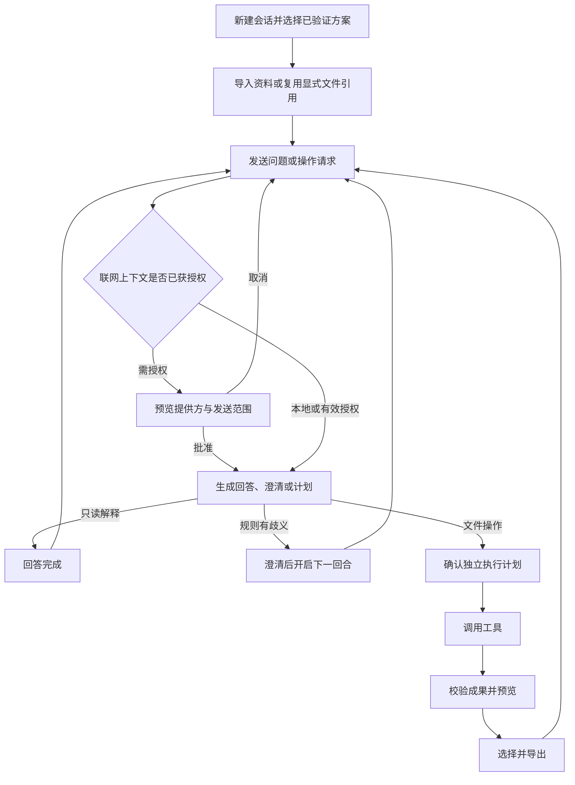

# Havenbox UI 与用户动线设计

版本：V0.5.1  
日期：2026-10-23  
状态：完整主方案与可点击演示；尚未完成真实接入或用户验证  
依据：[产品需求文档 V0.5](./product-requirements.md)，对应 F01～F27、S01～S19。

## 1. 设计决定与范围

Havenbox 采用以会话为主线的桌面工作台。用户在同一会话中导入资料、描述目标、确认计划、检查成果并继续追问。工作空间保存多个会话，但同时只运行一个回合或任务。

本期包括内置 Agent、Kimi CLI、Pi、DeepSeek Harness（dsh）、独立的本地与联网模型配置、受限推理网关、本地 MCP 和普通 CLI。Kimi ACP、Pi RPC、dsh SDK profile 是 PRD 提出的适配方向，具体版本、组合、恢复和工具能力尚待实测，界面不得将它们显示为已经支持。

本轮替换原先“文件列表作为左侧主导航”的方案，也不再以向导步骤作为常驻页面结构。首次准备和配置采用逐步提示，日常工作使用连续消息流。旧版 CSV 工作台与 MCP/CLI 补充稿保留为历史参考，不再代表当前产品范围。

本地与联网是并列路径。联网方案不要求安装本地模型，本地模型不承担联网方案的默认中转、审核或兜底。失败不自动换 harness、模型、提供方或模式。远程 MCP、订阅 OAuth、通用终端、多空间与后台任务队列仍不纳入本期。

## 2. 对象与信息架构

| 界面对象 | 用户需要理解的内容 | 主要入口 |
| --- | --- | --- |
| 会话 | 当前讨论、文件引用与连续工作记录 | 左侧会话栏 |
| 回合 | 一次发送及其回答、澄清或计划 | 中央消息流 |
| 执行任务 | 本轮批准的工具操作及成果 | 消息中的计划与任务卡片 |
| Harness | 谁编排任务，例如 Kimi CLI、Pi、dsh | 会话顶部、接入与方案 |
| 模型与连接 | 谁提供推理、端点、模型 ID、能力与宿主凭据引用 | 模型与连接 |
| MCP 与 CLI | 能调用哪些具体工具 | 接入与方案 |
| 执行方案 | Harness + 模型 + 工具权限 + 模式及限制 | 会话顶部、接入与方案 |
| 成果 | 哪个任务产生、是否完整、谁引用、是否已导出 | 右侧资料与成果 |

```text
Havenbox · 一个持久化工作空间
├─ 全局顶栏：环境状态、活动任务、停止、返回活动会话
├─ 会话侧栏：新建、标题搜索、归档筛选、会话列表
├─ 会话：执行方案摘要、连续消息、审批卡片、输入框
├─ 资料与成果：当前会话输入、成果、预览与导出
├─ 模型与连接：本地资源、API 提供方、凭据与能力检查
├─ 接入与方案：Harness、MCP、CLI、组合验证、保存方案
├─ 运行记录：按会话和任务关联的事件、错误、清理状态
└─ 设置：资源、版本、诊断、重启与清空工作空间
```

顶层导航稳定显示“会话”“模型与连接”“接入与方案”“运行记录”。设置属于低频维护。文件不再占据整个左栏，避免会话增加后没有位置展示连续工作。

## 3. 主工作台与视觉规格

建议 macOS 初始窗口 1360 × 860 pt，最小窗口 1024 × 700 pt，须在实际应用验证。桌面使用 208 pt 会话栏、弹性消息区、280 pt 资料与成果栏；宽度不足时将成果改为可展开面板。聊天中的窄屏演示纵向排列，不扩展产品平台承诺。

全局顶栏展示运行环境。会话标题下固定展示 harness、提供方、精确模型 ID、模式与工具范围。选择器显示当前方案，用户修改时进入“新建会话并切换”，不能直接改写当前会话的身份或历史。

活动任务提示跨页面保留，即使用户打开模型设置或其他会话，也能看到任务所属会话、真实阶段、返回与停止入口。活动状态不能仅存在于当前消息流中。

| Token | 浅色 | 深色 | 用途 |
| --- | --- | --- | --- |
| 背景 | `#F6F7F4` | `#171C19` | 应用工作区 |
| 表面 | `#FFFFFF` | `#202923` | 消息审批、预览、配置 |
| 主文字 | `#20372D` | `#E4ECE6` | 正文与标题 |
| 次文字 | `#596B60` | `#A7B7AC` | 来源、时间与辅助信息 |
| 主操作 | `#285A43` | `#ADD5B6` | 当前主要动作 |
| 主操作文字 | `#FFFFFF` | `#172A1D` | 按钮文字 |
| 分隔线 | `#DCE3DD` | `#3A493F` | 栏目与表格 |
| 待处理 | `#845211` | `#F0C07F` | 联网、澄清与未确认状态 |
| 错误 | `#A33332` | `#FFB0A7` | 失败与破坏操作 |

使用系统中文字体；正文 14 pt、次信息 12 pt、页面标题 24 pt，常规与中等字重。间距采用 8、12、16、24、32 pt；控件圆角 8 pt、审批卡片 12 pt。主按钮只强调当前阶段的下一步。状态同时提供文字，不单靠颜色表达。

## 4. 首次准备与执行方案

首次动线为检查隔离运行时、选择本地或联网、配置模型、检查工具与 harness 组合、保存方案、新建会话。初始化展示真实阶段，不展示虚构百分比和剩余时间。

本地路径选择离线包与受管运行时，校验完整性、量化版本、模型 ID、加载状态和能力。缺失只阻断依赖该模型的方案，不阻断联网配置。任务运行期不自动下载依赖。

联网路径选择服务商模板或自定义 API，不经过本地模型安装页。模型连接可以被多个兼容 harness 复用；选择 Kimi CLI 不会自动选择 Kimi 模型，Pi 或 dsh 也不因品牌被强制绑定某个提供方。

执行方案编辑器依次选择 harness、模型、模式、MCP/CLI 权限、推理参数及资源上限，展示最终组合。未经验证的组合可以保存草稿，但不能用于真实执行。验证记录绑定 harness 和适配器版本、协议、模型 ID、工具策略及检查版本；任一关键项变化后重新验证。

矩阵分别列出安装、会话协议、流式输出、工具审批、MCP 桥接、停止、原生恢复或历史重建策略。连接成功不等于组合验收通过。三种外部 harness 各须通过至少一条联网组合，另有至少一条本地离线组合，范围按 PRD 验收，不因设计复杂而删减。

## 5. 模型与连接

### 5.1 配置表单

| 类别 | 字段 | 展示与校验 |
| --- | --- | --- |
| 连接标识 | 显示名、提供方模板或自定义 API | 不以品牌推断协议 |
| 联网端点 | API 协议、Base URL、认证方式 | 宿主校验协议、域名、地址、端口与重定向 |
| 凭据 | API Key、凭据引用 | 交宿主安全存储；保存后不回显，可替换和删除 |
| 模型 | 精确模型 ID、上下文、输出上限 | 支持手填；列表接口失败不阻断单模型测试 |
| 推理参数 | 温度及协议支持的参数 | 以对应模型和适配器的实际 schema 为准 |
| 限制 | 超时、上下文、输出和用量上限 | 从受管配置读取，不虚构产品默认值 |
| 本地资源 | 离线包、校验和、量化版本、运行时与加载参数 | 受管路由，不向来宾暴露任意宿主服务 |

保存配置、凭据存在、端点连接、能力检查和组合验证分别显示。接口可达或模型列表成功都不足以显示“任务可用”。提供方数据保留政策入口与联网数据可能离开本机的说明放在配置页，不承诺上游不留存。

### 5.2 检查连接与管理凭据

“检查连接”先展示目标域名、模型 ID、固定测试提示与工具 schema，说明联网及可能计费，不发送业务文件或历史。授权后依次显示认证、响应协议、流式输出、工具能力的实际结果。错误分为端点不合法、认证失败、额度不足、协议不匹配、能力不支持和网络中断。

替换 Key、编辑端点或模型使旧检查及组合失效。删除连接或撤销凭据前列出受影响方案与活动任务；先阻断新请求，尽力取消在途请求并说明已发送数据或费用无法收回。历史仍可浏览，不自动改用其他连接。

设计演示不接收真实 Key；禁用密钥输入，通过“模拟保存凭据”展示状态变化。真实产品必须由宿主凭据接口完成保存，不能把 Key 存入网页状态、历史或来宾配置。

## 6. MCP、CLI 与 Harness 接入

“接入与方案”按 Harness、MCP、CLI 分组。Harness 显示 Kimi CLI、Pi、dsh 和内置 Agent 的独立条目。ACP、RPC、SDK profile 为适配方向标签，不等于已验证状态。

MCP 动线为选择预装本地服务、检查受管配置、启动与初始化、发现工具、批准具体权限、启用。发现工具不自动授权；工具描述按纯文本呈现，不能修改权限策略。初版不接受远程 URL、临时下载命令或任意宿主可执行文件。

权限分别列出 `inspect_csv`、`concat_csv`、`filter_rows`、`aggregate_csv`、`write_report` 及其读写效果。创建工作空间成果不等于允许宿主导出。服务状态区分未配置、检查中、待授权、就绪、使用中、停止中、已禁用和故障。

CLI 使用受管可执行文件和参数列表。普通用户通过输入文件、分组列、数值列、筛选规则与输出名表单配置，不输入 shell 字符串。高级详情展示工作目录、环境变量白名单、时限、输出限制、标准输出、标准错误及退出码。确定性 CLI 模板不需要模型，工具卡片可直接发起单独的待确认任务。

运行中修改或禁用接入项先说明受影响任务。用户停止后，等待调用、服务及子进程树清理确认，才显示已禁用或允许新任务。清理失败不能用关闭卡片伪装停止。配置与权限改变使相关待确认计划失效。

## 7. 多轮会话与任务动线



连续消息流按顺序保存用户输入、回答、澄清、计划和任务成果。任务完成后会话不关闭，输入框继续可用。用户可依次完成“汇总 CSV”“解释负数记录”“排除负数重新汇总”。后一次操作创建新任务与成果版本，保留前一结果；只读解释不弹工具执行确认。

普通文件任务先核对输入。导入副本须检查 CSV 编码、表头、字段、路径、符号链接与数量大小。逐文件展示失败原因，不能静默忽略错误条目。字段不匹配、关键列缺失和非法数值先暂停，不自行补零或丢行。

计划卡片展示当前任务输入快照、操作顺序、字段与条件、异常行是否参与计算、输出文件与写入范围、harness 与模型路由、工具权限及失败处理。只有确认后才执行，规则或引用变化后重新生成计划。

示例输入为六行销售额 `100、-20、200、120、150、150`，合计 `700.00`。按门店汇总为杭州 `200.00`、上海 `350.00`、苏州 `150.00`。排除负数后参与五行，合计 `720.00`，排除一行。数字来自确定性示例计算，不代表真实业务结果。

## 8. 联网数据授权与上下文

联网授权发生在第一次模型规划之前，不能等到工具执行时补做。授权面板列出提供方、端点域名、模型 ID、费用提示，以及任务文字、会话历史摘要、字段、文件片段和工具结果的实际发送清单。用户可预览、缩小范围或取消。

工具执行确认是另一项决定，不能用联网批准代替。网关凭证也不等于数据内容被限制：实现必须在上下文进入 harness 前校验文件与片段，并检查工具结果，观测实际请求是否符合授权。

初次汇总可只发送任务和字段；后续解释数值需要工具结果，则在发送前追加授权。历史摘要和跨会话带入内容也列入发送清单。范围不足时停止发送，不用模型先读取全部内容再决定是否批准。

设计演示为联网每轮展示发送面板，便于检查先后关系。真实产品可在同一会话内复用仍有效、来源和范围匹配的授权，但每轮重新检查任务凭证和内容；新提供方、新文件或超范围结果仍须再次确认。

## 9. 会话管理、切换与恢复

### 9.1 会话列表与单活动限制

侧栏提供新建、标题搜索、归档筛选、最近活动与状态。选中会话显示重命名、归档、删除入口。归档默认只读，取消归档并检查后可继续；删除单独确认，列明独有历史和附件的清理范围。

其他会话有活动回合时，可以浏览、编辑草稿、新建空会话，但不能发送。不提供排队承诺。全局提示始终指向活动会话；切换浏览不会取消任务，也不把其进度混入当前会话消息。

活动会话归档或删除前须先停止并确认进程清理。删除只清理独有引用，保留其他会话仍引用的成果、宿主原件与已导出文件。跨会话复用通过显式选择和引用记录完成，不自动共享全部文件。

### 9.2 切换方案

修改 harness、模型或模式时进入“新建会话并切换”。默认不带入历史、文件或内部状态；可勾选预览过的摘要及文件引用。目标联网提供方的首次发送重新授权，不能沿用来源会话批准。

运行时先返回活动任务并停止，不允许改写在途快照。工具权限变化使旧计划失效；已有任务仍按其原快照保留记录。

### 9.3 恢复历史与继续对话

重启首先展示消息和成果，再校验版本、原生会话、文件、模型和权限。检查通过才显示“可原生继续”；不能恢复时显示“预览摘要并新建会话”。旧会话仍可读，摘要重建不得标为原生恢复。

中断回复标为“回复未完成”，未知工具结果标为“操作结果待核查”，分别展示。恢复不自动重发请求、重放工具或使用旧批准。未知结果先查记录与已有成果，核查后由用户发起新回合和必要计划。

上下文超限时展示摘要和省略范围，保留可浏览原始历史。当前会话上下文不混入其他会话数据。记录损坏或文件缺失不阻断仍完好的历史，继续入口展示需要修复的前置条件。

## 10. 成果、停止与异常

右侧只列当前会话可访问的输入与成果，标注来源任务、版本、完整性与导出状态。CSV 按纯数据表格预览，Markdown 安全渲染；大文件说明预览 N 行与实际总行数，不加载远程资源或执行脚本。

导出为选择成果、预览、选择宿主位置、检查覆盖与公式风险、写入并报告逐文件结果。覆盖默认不执行；提供替换、另存或跳过。公式风险提示在写入前，转义版本需单独标识，不静默改变原始数据。未完成成果默认不选，导出时明确标识未完成。部分失败只重试失败项。

停止先显示“正在停止”，涵盖推理、MCP 调用、服务及 CLI 子进程树。只有收到真实终止确认才释放单活动限制。清理失败提供关闭工作空间的兜底动作，不显示任务成功。运行中退出提供“停止并退出”和“继续任务”，不转后台。

| 异常 | 展示与恢复 |
| --- | --- |
| 模型失败、认证或额度错误 | 保留会话与成果，区分原因，手动修复，不自动改路由 |
| 未验证或不兼容组合 | 禁用执行并展示具体能力缺口，仍可编辑配置 |
| MCP 错误或 CLI 非零退出 | 定位服务、工具、参数与退出码，不把部分输出标为成功 |
| 退出码为零但结果校验失败 | 显示结果失败，保留诊断，不能只以退出码判断 |
| 流式断开 | 回复未完成，不自动重发可能计费的请求 |
| 工具结果未知 | 先核查调用与成果，不盲目重试写入 |
| 资源不足或超限 | 显示真实限制与受影响步骤，手动恢复，不无限重试 |
| 导出失败 | 显示目标、文件与错误，仅重试失败项 |

设置中清空需二次确认，说明删除输入副本、成果、消息与任务记录，保留模型资源、宿主原件和已导出文件。运行中先停止。提供方凭据另有独立撤销入口，不暗示清空工作空间会撤回已发给上游的数据；清空不是法证级安全擦除。

## 11. 可访问性与交接要求

控件使用原生语义、明确标签和可见焦点。表格金额右对齐并使用等宽数字，长文件名可换行或查看全名。错误关联字段，状态变化适度播报，不逐行朗读日志。触控有效目标至少 44 pt，支持系统字号与减少动态效果。

建议快捷键为 `⌘N` 新会话、`⌘O` 导入、`⌘Enter` 发送、`⌘,` 设置；发送快捷键不能跳过联网授权或计划确认。审批面板移入焦点，关闭后返回触发位置；Escape 只取消可取消面板，不自动停止任务或丢弃草稿。

实现需要稳定的会话、回合、任务、调用与文件版本 ID，前端消费实际事件。恢复与重新连接按 ID 去重；前端禁用按钮不能替代后端并发、权限、路由、参数和文件校验。日志是脱敏纯文本，不解释控制序列，也不执行其中指令。

## 12. 原型覆盖与验收

本轮主原型为会话式工作台，覆盖会话列表与草稿、搜索与管理、新建与方案切换、模型配置与检查授权、组合验证、本地 MCP/CLI 权限、联网先授权后规划、多轮问答与顺序任务、成果预览与模拟导出、活动任务跨页面可见、停止、失败、历史核查与摘要重建。

所有“检查通过”“已保存”“已停止”都在明确的演示横幅下模拟。真实 API Key 输入关闭，不进行网络请求、模型调用、文件读取写入或进程启动。样例兼容状态不能用于产品接入验收。原型状态仅在当前渲染生命周期内保留，不把刷新伪称持久化或真实重启。

设置已包含模拟重启后检查恢复、二次确认清空。退出、真实 CSV 导入失败、完整覆盖冲突和公式风险弹层由本文定义，尚未制作全部高保真交互。实际版本、资源上限、真实服务商模板、原生恢复策略和所有安全边界仍由实现与实测确定。

验收按以下场景执行：

1. 本地方案完成汇总、解释、改规则再次汇总，保留两份成果。
2. 无本地模型时配置联网模型；拒绝数据授权后不发业务请求，批准后再规划。
3. 一个提供方模型复用到 Kimi CLI、Pi、dsh 的候选方案，未验证组合不能执行。
4. 检查连接只用固定测试提示，保存、连接和能力状态相互独立；替换凭据使旧组合失效。
5. 两条会话隔离消息、草稿与文件。活动任务跨页面可见，其他会话不能并发发送。
6. 切换方案新建会话，带入摘要与文件引用必须显式勾选，联网发送重新授权。
7. 中断历史先可读，原生继续需检查；未知工具结果不自动重放，摘要重建先预览。
8. 删除一条会话不删除其他会话仍引用的成果、宿主原件或导出文件。
9. MCP 未授权工具、CLI 参数越界、认证失败、停止清理失败与输出校验失败均有可诊断状态。

以上为设计验收，不替代 PRD 第 13 节真实 harness、模型、离线、联网、隔离及用户试用验收。


## 13. 本轮实际验证记录

原型已保存至 [doc/prototypes](./prototypes/README.md)，包含可编辑源稿、独立页面、构建器和状态检查脚本。详细结果见 [原型检查记录](./prototypes/verification.md)。

已通过本地 HTTP 服务在实际浏览器打开各页面，检查本地多轮、联网授权、模型与组合配置、MCP 与 CLI、活动任务、恢复、停止与异常。发现并修正输出文件名不一致、重绘后焦点丢失、清理失败缺少兜底入口等问题，修改后复核相关流程。桌面与窄屏页面截图已保存。

JavaScript 状态检查、独立构建及文档引用检查通过。浏览器检查对象仍是模拟原型，不是实际产品；真实 harness、模型、持久化、凭据、网络隔离与进程清理尚未验证。浅色外观、VoiceOver 与系统字号也未测试。
